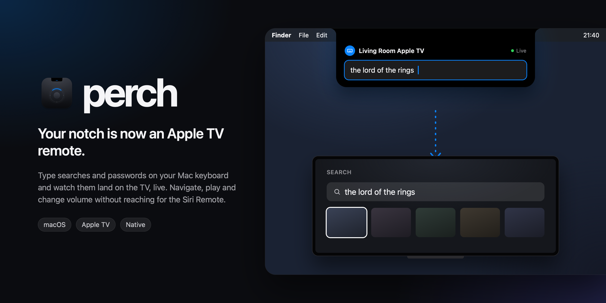

<p align="center"></p>

an apple tv remote for macs with a notch.

it sits beside the notch with a small tv and a dot that tells you it's connected. hover over it, or hit ⌥T, and it opens into a remote: arrows, back, home, play/pause, volume, and what's playing. move away and it tucks back in.

the part i built it for: when the tv wants text, a search box or a password, the notch tells you, and you type on your mac keyboard instead of hunting for letters with a remote. it shows up on the tv as you type.

## what it does

- a tv and a status dot on the right of the notch, the artwork of what's playing on the left
- hover, click, or swipe down with two fingers to open the remote
- arrows, select, back, home, play/pause, sleep and volume, by click or from the mac keyboard: arrow keys move, return selects, esc goes back, space plays, ⌘↑ and ⌘↓ change the volume
- what's playing, with the artwork, how far in it is, and 10 second skips
- when the tv asks for text, a blue keyboard badge pulses in the notch. open perch and the text field is already there, holding whatever the tv has in it
- when the tv starts playing something, the notch says so for a couple of seconds
- finds the apple tvs on your network and pairs with the pin the tv shows, once. after that it reconnects on its own, also after your mac wakes up
- ⌥T opens and closes it from anywhere. you can change the shortcut in setup
- menu bar full? it shrinks to a thin line under the notch and stays out of the way of your menus
- it shares the notch with [tuno](https://github.com/kaanf/tuno): tuno takes the left side, perch the right, and only one of them is open at a time
- no notch? it draws one at the top of your screen

## what's not in yet

- the volume level. you can change it, you can't see where it is
- a way to press "search" or "done" on the tv's keyboard. you type, hit return, then navigate
- switching between several apple tvs without unpairing
- swiping on a touchpad, and dictation

## installing

grab `Perch-x.y.z.dmg` from the [releases page](https://github.com/kaanf/perch/releases), open it and drag perch into applications. it's signed and notarized, and runs on apple silicon macs with macos 14 or later.

the first time it opens you get a small setup window for the permissions below, the shortcut, and whether it starts at login. then it lists the apple tvs on your network; pick yours and type the pin it shows.

## building

if you'd rather build it yourself:

```sh
./build.sh
open build/Perch.app
```

you need macos 14 or later and the xcode command line tools. it expects [notch-kit](https://github.com/kaanf/notch-kit) checked out as `NotchKit` and [perch-core](https://github.com/kaanf/perch-core) as `perch-core`, both next to this folder.

the build signs with my developer certificate when it's on the machine, and falls back to ad-hoc signing otherwise. to use your own, run `IDENTITY="your cert name" ./build.sh`. the pairing keys are in the keychain, so with ad-hoc signing macos may ask for your login password again after a rebuild.

one thing that cost me an afternoon: macos gives local network access to the exact binary. rebuild while perch is running and the running copy loses the tv until you restart it, so `build.sh` quits it first.

no apple tv at hand? a debug build can fake one:

```sh
CONFIGURATION=debug ./build.sh
open build/Perch.app --args --mock-tv playing --open
```

the scenarios are `unpaired`, `pairing`, `connecting`, `idle`, `playing`, `keyboard`, `failed` and `network-denied`, and the notch's right-click menu switches between them.

## permissions

- **local network**: needed. it's how perch finds your apple tv and talks to it
- **accessibility**: optional, and only for one thing. it lets perch see where the frontmost app's menus end, so its left side can get out of their way. without it perch still works, it just can't tell when the menus are long

the setup window asks for both and tells you when they went through. right click the notch and choose "Kurulum ve İzinler…" to open it again. there's no menu bar icon, so that's how you get in.

the interface is in turkish for now.

## how it works

apple doesn't document how its own remote app talks to the tv. [perch-core](https://github.com/kaanf/perch-core) does that part: the buttons, typing and app list go over the companion link protocol, and what's playing comes from the media remote protocol tunnelled through airplay. it wouldn't exist without [pyatv](https://github.com/postlund/pyatv), which worked all of this out years ago.

the window over the notch, its shape and the way it opens come from [notch-kit](https://github.com/kaanf/notch-kit), which also keeps perch and tuno from stepping on each other.

what's left here is the app itself. the interface never touches perch-core directly; it talks to a small protocol that the real tv and the fake one both implement, which is why the whole thing can be tried without a tv.

## project layout

```text
Sources/App/TVSession.swift            what the interface knows about the tv
Sources/App/LiveTV.swift               the real tv, through perch-core
Sources/App/MockTV.swift               the fake one, debug builds only
Sources/App/RemoteModel.swift          which screen is up, what the notch says
Sources/App/RemoteController.swift     the notch, the shortcut, and keeping them in step
Sources/App/KeyCommands.swift          what each key on the mac does
Sources/App/RemotePanel.swift          the open remote
Sources/App/TypingPanel.swift          keyboard mode
Sources/App/SetupPanels.swift          tv list, pin, and what can go wrong
Sources/App/SetupWindow.swift          the first-run permissions window
Sources/App/CompactViews.swift         the wings, the line and the request pill
Resources/Icon/, Resources/DMG/        icon and dmg background sources (svg)
scripts/                               rendering those, and making a release
```

## privacy

everything stays on your network. perch talks to your apple tv and nothing else: no accounts, no analytics, no servers. the pairing keys are in your keychain, and what you type goes to the tv and isn't kept.

## license

mit, see [LICENSE](LICENSE).

---

made by Kaan Fırat
